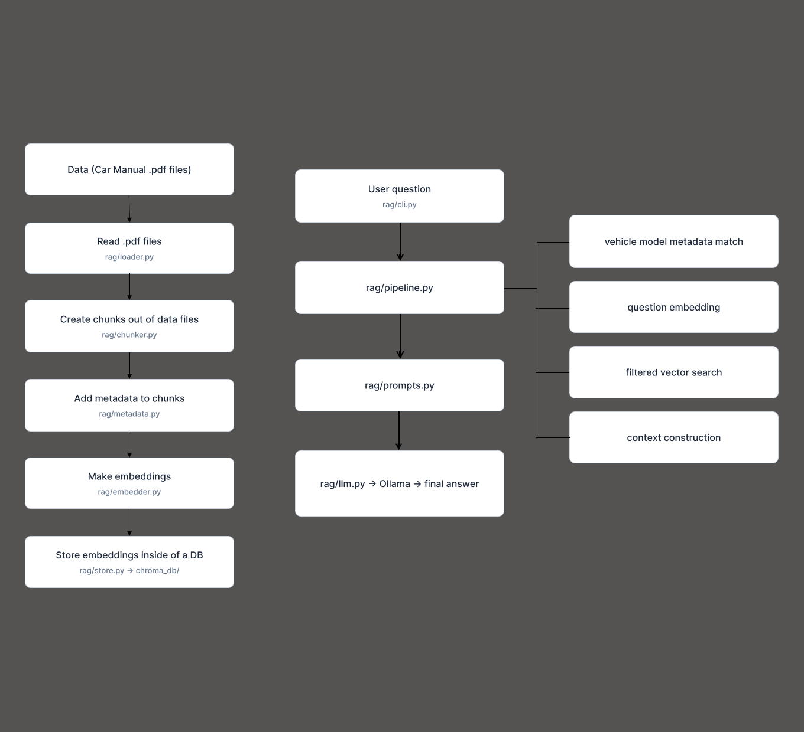

# Car Support RAG

A local retrieval-augmented generation (RAG) application for answering
questions from vehicle manuals. The application uses PDF manuals as its
knowledge base, ChromaDB for vector storage, and Ollama for embeddings and
answer generation.

## Features

- PDF text extraction with `pypdf`
- Overlapping text chunking
- Metadata attached to every chunk
- Vehicle model selection from the user's question
- Persistent ChromaDB vector storage
- Automatic indexing of new manuals in `data/`
- Local embeddings and chat generation through Ollama
- Command-line interface

## How it works



Manuals are loaded, split into chunks, enriched with metadata, embedded, and
stored in ChromaDB. When a question is asked, the vehicle model is matched
against the stored metadata before relevant chunks are retrieved and sent to
the language model.

## Requirements

- Python 3.10 (ChromaDB tends to have a problem with newer version from my experience)
- Ollama
- `nomic-embed-text`
- `deepseek-r1`

Install the Ollama models:

```bash
ollama pull nomic-embed-text
ollama pull deepseek-r1
```

Start Ollama before using the application:

```bash
ollama serve
```

## Installation

Create and activate a virtual environment:

```bash
python -m venv .venv
source .venv/bin/activate
```

On Windows PowerShell:

```powershell
python -m venv .venv
.\.venv\Scripts\Activate.ps1
```

Install the dependencies:

```bash
pip install -r requirements.txt
```

## Manual files

Place PDF manuals in the `data/` directory:

```text
data/
├── Alfa_Romeo_147.pdf
├── Hyundai_ix35.pdf
└── Seat_Toledo.pdf
```

The vehicle model is derived from the filename. For example:

```text
Seat_Toledo.pdf -> Seat Toledo
```

Use descriptive filenames so the model can be identified from a question.

## Usage

Ask a question from the project root:

```bash
python -m rag.cli ask "Where can I find the tyre pressure values on a Seat Toledo?"
```

The first question automatically:

1. Creates the ChromaDB database.
2. Finds PDF manuals in `data/`.
3. Indexes manuals that are not already stored.
4. Matches the vehicle model in the question.
5. Retrieves relevant chunks from the matching manual.
6. Generates an answer using the retrieved context.


The vehicle model must be included in the question. If it is missing or
ambiguous, the application asks for a specific model instead of searching
across unrelated manuals.

## Project structure

```text
.
├── data/                 PDF vehicle manuals
├── images/               README images
├── rag/
│   ├── chunker.py        Split documents into chunks
│   ├── cli.py            Command-line interface
│   ├── embedder.py       Generate text embeddings
│   ├── llm.py            Call the Ollama chat API
│   ├── loader.py         Extract text from PDFs
│   ├── metadata.py       Create chunk metadata
│   ├── pipeline.py       Coordinate ingestion and retrieval
│   ├── prompts.py        Define prompts and context formatting
│   └── store.py          Store and search ChromaDB records
├── requirements.txt
└── README.md
```

## Configuration defaults

| Setting | Default |
|---|---|
| Data directory | `./data` |
| ChromaDB directory | `./chroma_db` |
| Collection name | `rag` |
| Embedding model | `nomic-embed-text` |
| Chat model | `deepseek-r1` |
| Chunk size | `800` characters |
| Chunk overlap | `100` characters |
| Retrieved chunks | `5` |
